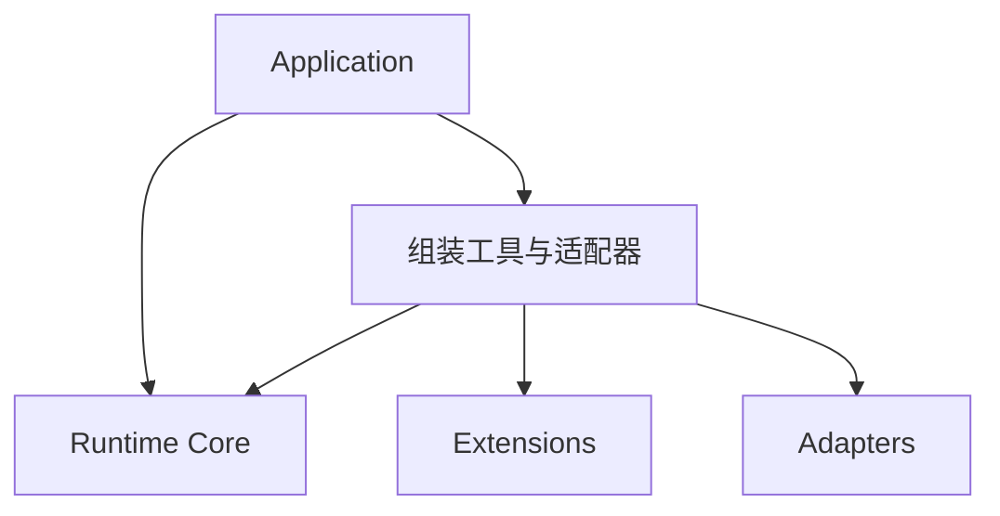

# 架构与 Phase 1 接口草案

图展示目标架构。应用负责注入依赖，Runtime 依赖自己定义的接口。模型适配器返回文本或工具请求，由 Runtime 执行层检查权限后调用工具。Phase 0 只有离线 Mock 和核心 TODO。

核心接口与核心逻辑由项目负责人设计和实现。工程协作可以提供接口草案、外部测试和代码审查。修改核心接口或逻辑需要负责人针对具体改动授权。

## 待负责人确认的最小边界

| 模块 | 建议接口或数据 |
| --- | --- |
| `models.py` | `Message` 保存角色和内容。后续加入工具调用 ID。模型输出可先用文本，进入工具调用阶段时再考虑用 `FinalReply \| ToolRequestBatch` 明确区分两种响应。 |
| `loop.py` | 先验证单轮文本路径，再引入步骤预算、终止原因和工具结果回填。 |
| `registry.py` | 提供按名称查找工具描述、Schema 和 handler 的接口。参数校验及结果标准化由负责人决定归属。 |
| `permissions.py` | 工具调用前传入调用信息和授权上下文，返回允许、拒绝或待审批。未知操作默认拒绝。 |
| `context.py` | 提供有序消息快照和显式追加接口，持久化由外部 Adapter 接入。 |
| `trace.py` | 核心发出带运行 ID、步骤和事件类型的记录，外部 sink 负责存储和导出。 |

## 第一个函数

在 `core/loop.py` 编写单轮同步入口，候选签名为
`run_once(user_text: str, model: TextModel) -> str`。
`TextModel` 可先定义为仅含 `complete(request: str) -> str` 的协议。
这个薄入口用于验证依赖注入、模型调用和返回路径。接口仍由负责人决定。

| 场景 | 验收标准 |
| --- | --- |
| 成功 | 用 `MockLLM[str, str](["服务正常"])` 调用，函数返回 `"服务正常"`。 |
| 调用次数及输入 | `model.requests == ("检查服务状态",)`，验证原始输入和恰好一次调用。 |
| 模型失败 | 注入 `TimeoutError`，异常传给调用者，Mock 记录一次调用。 |

Phase 1 验收测试在接口确认后编写。Phase 0 的测试覆盖 Mock。
